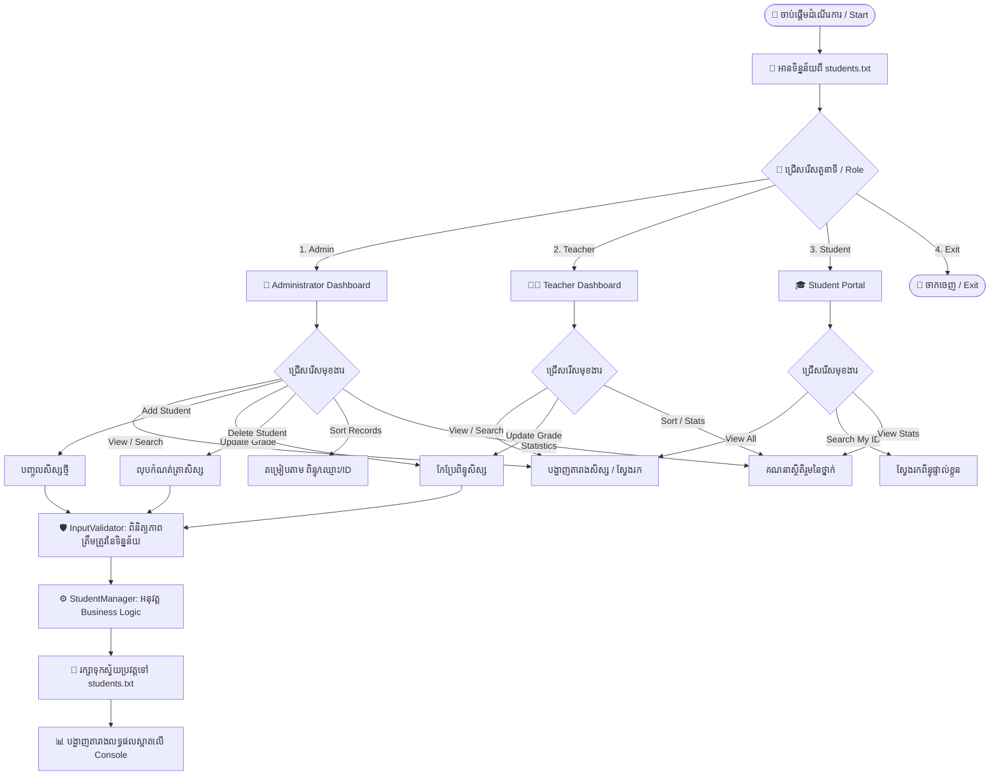

# ប្រព័ន្ធគ្រប់គ្រងសិស្ស (Student Management System - SMS)
> **Java OOP Midterm Project - ប្រធានបទទី ២ (Topic 2)**  
> *កម្មវិធី Console-Based ដ៏រៀបរយ បង្កើតឡើងដោយអនុវត្តតាមគោលការណ៍ Object-Oriented Programming (OOP) ពេញលេញ និងមានប្រព័ន្ធបែងចែកសិទ្ធិប្រើប្រាស់ (Role-Based Access Control)*

---

## 📑 មាតិកា (Table of Contents)
1. [គោលបំណងនៃគម្រោង (Overview)](#-១-គោលបំណងនៃគម្រោង)
2. [ដ្យាក្រាមដំណើរការនៃគម្រោង (System Workflow Diagram)](#-២-ដ្យាក្រាមដំណើរការនៃគម្រោង)
3. [ដ្យាក្រាមស្ថាបត្យកម្ម OOP (OOP Architecture Diagram)](#-៣-ដ្យាក្រាមស្ថាបត្យកម្ម-oop)
4. [មុខងារសំខាន់ៗ (Key Features)](#-៤-មុខងារសំខាន់ៗ)
5. [លក្ខខណ្ឌកាត់ពិន្ទុ និងលទ្ធផលសិក្សា (Grading & Status Rules)](#-៥-លក្ខខណ្ឌកាត់ពិន្ទុ-និងលទ្ធផលសិក្សា)
6. [ការបែងចែកសិទ្ធិប្រើប្រាស់ (Role-Based Access Matrix)](#-៦-ការបែងចែកសិទ្ធិប្រើប្រាស់)
7. [បញ្ជី Classes និង OOP Concepts ដែលបានអនុវត្ត](#-៧-បញ្ជី-classes-និង-oop-concepts)
8. [របៀប Compile និង Run កម្មវិធី](#-៨-របៀប-compile-និង-run-កម្មវិធី)
9. [ទម្រង់ឯកសាររក្សាទុកទិន្នន័យ (students.txt)](#-៩-ទម្រង់ឯកសាររក្សាទុកទិន្នន័យ)

---

## 🎯 ១. គោលបំណងនៃគម្រោង
គម្រោង **Student Management System (SMS)** ត្រូវបានរៀបចំឡើងដើម្បី៖
* កត់ត្រា និងគ្រប់គ្រងទិន្នន័យសិស្ស (ID, ឈ្មោះ, ពិន្ទុ)។
* គណនាលទ្ធផលសិក្សាដោយស្វ័យប្រវត្ត៖ **PASS** ($\ge 60$), **RE-EXAM** ($20 - 59.9$), និង **RE-STUDY** ($< 20$)។
* អនុវត្តគោលការណ៍ **OOP ទាំង ៤ (Abstraction, Encapsulation, Inheritance, Polymorphism)** ព្រមទាំង **Interface** និង **Collections**។
* បង្កើតប្រព័ន្ធការពារកំហុស **Data Validation** មិនឱ្យកម្មវិធីគាំង (Zero-Crash) ពេលវាយបញ្ចូលទិន្នន័យខុស។
* រក្សាទុកទិន្នន័យចូលក្នុងឯកសារ `students.txt` (Data Persistence) ដោយមិនបាត់បង់ទិន្នន័យពេលបិទកម្មវិធី។

---

## 🔄 ២. ដ្យាក្រាមដំណើរការនៃគម្រោង

ដំណើរការប្រតិបត្តិការរបស់កម្មវិធីតាំងពីចាប់ផ្តើមរហូតដល់បញ្ចប់៖



---

## 🏗️ ៣. ដ្យាក្រាមស្ថាបត្យកម្ម OOP

រចនាសម្ព័ន្ធទំនាក់ទំនងរវាង Classes ទាំងអស់៖


---

## ✨ ៤. មុខងារសំខាន់ៗ

### Core Features (លក្ខខណ្ឌស្នូលរបស់ Topic 2)
1. **Add New Student:** ចុះឈ្មោះសិស្សថ្មី (ពិនិត្យមិនឱ្យស្ទួន ID)។
2. **View All Students:** បង្ហាញបញ្ជីសិស្សទាំងអស់ជាតារាង ASCII ស្អាត រៀបរយ ព្រមទាំង Grade Letter និង Status។
3. **Update Student's Grade:** កែប្រែពិន្ទុសិស្ស (កំណត់ឱ្យវាយបានតែចន្លោះ `0.0` ដល់ `100.0`)។
4. **Delete Student Record:** លុបសិស្សចេញពីប្រព័ន្ធ (មានផ្ទៀងផ្ទាត់បញ្ជាក់ច្បាស់លាស់ `y/n`)។

### Optional Enhancements (មុខងារបន្ថែមពិសេស)
* **Search System:**
  * ស្វែងរកតាមលេខសម្គាល់សិស្ស (Student ID)។
  * ស្វែងរកតាមឈ្មោះសិស្ស (Partial Keyword Match)។
* **Sorting System (ជម្រើសតម្រៀប ៤ បែប):**
  * តម្រៀបតាមពិន្ទុពីខ្ពស់ទៅទាប (Highest to Lowest)
  * តម្រៀបតាមពិន្ទុពីទាបទៅខ្ពស់ (Lowest to Highest)
  * តម្រៀបតាមឈ្មោះសិស្ស (A – Z)
  * តម្រៀបតាម Student ID
* **Class Statistics (ស្ថិតិរួមនៃថ្នាក់):**
  * ចំនួនសិស្សសរុប
  * មធ្យមភាគពិន្ទុទូទាំងថ្នាក់ (Class Average)
  * សិស្សដែលទទួលបានពិន្ទុខ្ពស់បំផុត និងទាបបំផុត
  * ចំនួន និងភាគរយសិស្ស **PASS**, **RE-EXAM**, និង **RE-STUDY**
* **File Persistence:** ផ្ទុកទិន្នន័យចូល `students.txt` ដោយស្វ័យប្រវត្តរាល់ពេលមានការផ្លាស់ប្តូរ។

---

## 📊 ៥. លក្ខខណ្ឌកាត់ពិន្ទុ និងលទ្ធផលសិក្សា

| កម្រិតពិន្ទុ (Score Range) | និទ្ទេស (Grade Letter) | ស្ថានភាព (Status) | អត្ថន័យ |
| :---: | :---: | :---: | :--- |
| **$90.0 - 100.0$** | **A** | **`PASS`** | ជាប់កម្រិតល្អឥតខ្ចោះ (Excellent) |
| **$80.0 - 89.9$** | **B** | **`PASS`** | ជាប់កម្រិតល្អណាស់ (Very Good) |
| **$70.0 - 79.9$** | **C** | **`PASS`** | ជាប់កម្រិតល្អ (Good) |
| **$60.0 - 69.9$** | **D** | **`PASS`** | ជាប់កម្រិតមធ្យម (Fair Pass) |
| **$20.0 - 59.9$** | **E** | **`RE-EXAM`** | ប្រឡងសង (Remedial Examination) |
| **$< 20.0$** | **F** | **`RE-STUDY`** | ធ្លាក់ ត្រូវរៀនឡើងវិញ (Repeat Subject) |

---

## 🛡️ ៦. ការបែងចែកសិទ្ធិប្រើប្រាស់

| មុខងារ / សកម្មភាព | Administrator | Teacher | Student |
| :--- | :---: | :---: | :---: |
| មើលបញ្ជីសិស្សទាំងអស់ (View All) | ✅ | ✅ | ✅ |
| ស្វែងរកតាមលេខ ID (Search by ID) | ✅ | ✅ | ✅ |
| ស្វែងរកតាមឈ្មោះ (Search by Name) | ✅ | ✅ | ❌ |
| មើលស្ថិតិរួមនៃថ្នាក់ (View Class Statistics) | ✅ | ✅ | ✅ |
| តម្រៀបទិន្នន័យ (Sort Records) | ✅ | ✅ | ❌ |
| កែប្រែពិន្ទុសិស្ស (Update Student Grade) | ✅ | ✅ | ❌ |
| បន្ថែមសិស្សថ្មី (Add Student) | ✅ | ❌ | ❌ |
| លុបសិស្សចេញពីប្រព័ន្ធ (Delete Student) | ✅ | ❌ | ❌ |
| Reload ទិន្នន័យពី File ឡើងវិញ | ✅ | ❌ | ❌ |

---

## 🧩 ៧. បញ្ជី Classes និង OOP Concepts

1. **[Person.java](file:///Users/Lemeng/BBU/OOP-JAVA/School-management-system/src/sms/Person.java) (`sms.Person`):**
   * **OOP Concepts:** `Abstraction` & `Encapsulation`
   * ជា Superclass មេប្រភេទ `abstract class` ដែលមាន attributes `private id`, `private name` និង abstract methods `getRole()` និង `displayInfo()`។
2. **[Student.java](file:///Users/Lemeng/BBU/OOP-JAVA/School-management-system/src/sms/Student.java) (`sms.Student`):**
   * **OOP Concepts:** `Inheritance`, `Polymorphism`, `Encapsulation`
   * ទទួលមរតកពី `Person` (`extends Person`) បន្ថែមពិន្ទុ `grade` ព្រមទាំង Overriding មុខងារគណនា Letter Grade និង Status។
3. **[Teacher.java](file:///Users/Lemeng/BBU/OOP-JAVA/School-management-system/src/sms/Teacher.java) (`sms.Teacher`):**
   * **OOP Concepts:** `Inheritance`, `Polymorphism`
   * ទទួលមរតកពី `Person` បន្ថែមផ្នែកបង្រៀន `department`។
4. **[Admin.java](file:///Users/Lemeng/BBU/OOP-JAVA/School-management-system/src/sms/Admin.java) (`sms.Admin`):**
   * **OOP Concepts:** `Inheritance`, `Polymorphism`
   * ទទួលមរតកពី `Person` បន្ថែមការិយាល័យ `office`។
5. **[Manageable.java](file:///Users/Lemeng/BBU/OOP-JAVA/School-management-system/src/sms/Manageable.java) (`sms.Manageable`):**
   * **OOP Concepts:** `Interface` & `Generic Type`
   * កំណត់ Standard Methods សម្រាប់ប្រតិបត្តិការ CRUD (`add`, `delete`, `findById`, `getAll`, `displayAll`, `size`)។
6. **[StudentManager.java](file:///Users/Lemeng/BBU/OOP-JAVA/School-management-system/src/sms/StudentManager.java) (`sms.StudentManager`):**
   * **OOP Concepts:** `Interface Implementation`, `Collections (List<Student>)`, `File I/O`
   * គ្រប់គ្រង Business Logic ទាំងអស់នៃការងារ Add, Update, Delete, Sort, Search, គណនាស្ថិតិ និង Auto Save/Load CSV File។
7. **[InputValidator.java](file:///Users/Lemeng/BBU/OOP-JAVA/School-management-system/src/sms/InputValidator.java) (`sms.InputValidator`):**
   * **OOP Concepts:** `Data Validation Utility`
   * ធានាថាកម្មវិធីមិនគាំង (Zero-Crash) ទោះបីជាអ្នកប្រើវាយខុសអក្សរ លេខ ឬចុច Enter ទំនេរក៏ដោយ។
8. **[Main.java](file:///Users/Lemeng/BBU/OOP-JAVA/School-management-system/src/sms/Main.java) (`sms.Main`):**
   * **OOP Concepts:** `Controller & Menu Interface`
   * មាន `main()` ខ្លីស្របតាមលក្ខខណ្ឌកំណត់ និងគ្រប់គ្រងដំណើរការ Menu តាម Role នីមួយៗ។

---

## 💻 ៨. របៀប Compile និង Run កម្មវិធី

### វិធីទី ១: ប្រើ Script ស្វ័យប្រវត្ត (ងាយស្រួលបំផុត)
* **នៅលើ macOS / Linux:**
  ```bash
  ./run.sh
  ```
* **នៅលើ Windows:**  
  ចុច Double-click លើ file `run.bat`

### វិធីទី ២: ប្រើ Terminal Command
```bash
# ១. Compile កូដទាំងអស់ទៅក្នុង folder out
javac -d out src/sms/*.java

# ២. Run កម្មវិធី
java -cp out sms.Main
```

### វិធីទី ៣: ប្រើ VS Code ឬ IntelliJ IDEA
1. បើក Folder គម្រោងនេះនៅក្នុង IntelliJ IDEA ឬ VS Code។
2. បើកឯកសារ `src/sms/Main.java`។
3. ចុចប៊ូតុង **Run** (ប៊ូតុងត្រីកោណពណ៌បៃតង) ឬចុច `F5` / `Shift + F10`។

---

## 💾 ៩. ទម្រង់ឯកសាររក្សាទុកទិន្នន័យ

ទិន្នន័យត្រូវបានរក្សាទុកក្នុង [students.txt](file:///Users/Lemeng/BBU/OOP-JAVA/School-management-system/students.txt) ជាទម្រង់ CSV ស្តង់ដារ៖
```csv
STU001,Sokha Chan,88.50
STU002,Dara Heng,94.00
STU003,Bopha Pich,45.00
STU005,Chenda Srun,62.00
STU006,Chhoeng Chhat,59.00
```
រាល់ពេលអ្នកបន្ថែម កែប្រែ ឬលុបទិន្នន័យ ឯកសារនេះនឹងត្រូវបាន Update ភ្លាមៗដោយស្វ័យប្រវត្ត។

---
**Build Bright University (BBU) — Faculty of Science and Technology**  
*Java OOP Midterm Project — Academic Year 2026*
