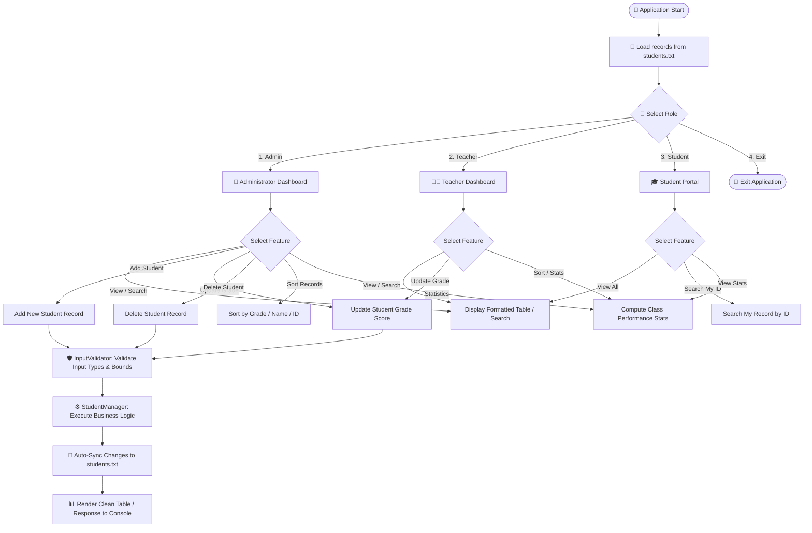
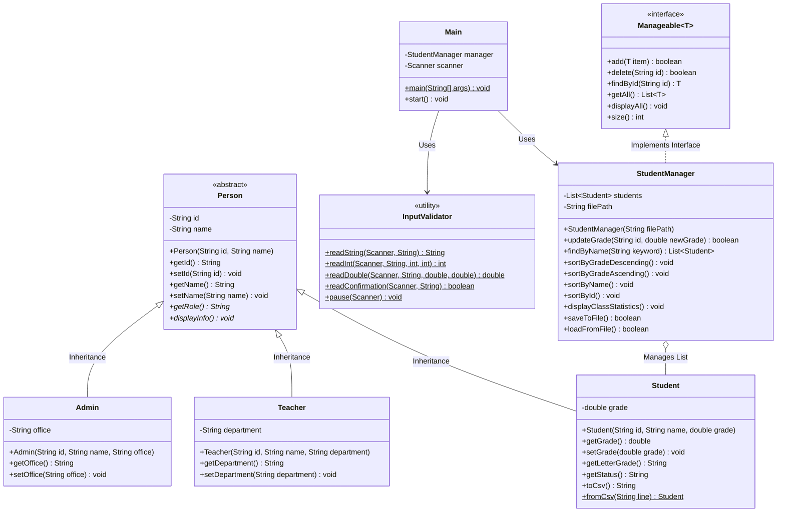

# Student Management System (SMS)
> **Java OOP Midterm Project - Topic 2**  
> *A modular, robust, and menu-driven console application built with Object-Oriented Programming (OOP) principles in Java.*

---

## 📖 1. Overview
The **Student Management System (SMS)** is an academic console-based Java application designed to store, manage, and analyze student academic records. The system incorporates **Role-Based Access Control (RBAC)** allowing Administrators, Teachers, and Students to interact with records based on their designated privileges.

---

## 🔄 2. System Workflow Diagram



---

## 🏗️ 3. OOP Architecture Diagram



---

## ✨ 4. Key Features

### Core Features (Topic 2 Requirements)
* **Add New Student**: Register a new student with unique ID, full name, and grade score.
* **View All Students**: Display all students in a neatly formatted, aligned table including numerical grade, letter grade (`A`–`F`), and status (`PASS` / `RE-EXAM` / `RE-STUDY`).
* **Update Student Grade**: Modify grade scores with range validation (`0.0` – `100.0`).
* **Delete Student Record**: Remove student records with confirmation prompts.

### Optional Enhancements Included
* **Search Functionality**:
  * Search by exact Student ID.
  * Search by Student Name (case-insensitive keyword matching).
* **Sorting Capabilities**:
  * Sort by Grade (Highest to Lowest).
  * Sort by Grade (Lowest to Highest).
  * Sort by Student Name (A–Z).
  * Sort by Student ID.
* **Class Performance Statistics**:
  * Total student count.
  * Class average grade score.
  * Highest and lowest performing student identification.
  * Pass (`>= 60.0`), Re-Exam (`20.0`–`59.9`), and Re-Study (`< 20.0`) breakdown with percentages.
* **File Persistence**:
  * Auto-loads records from `students.txt` on startup.
  * Preloads sample data if no file is present.
  * Auto-saves every modification to ensure data persistence across sessions.
* **Robust Input Validation**:
  * Zero runtime crashes from mismatched input types (`letters` vs `numbers`).
  * Empty input prevention and out-of-range protection.

---

## 📊 5. Academic Grading & Evaluation Model

| Score Range | Letter Grade | Academic Status | Meaning |
| :---: | :---: | :---: | :--- |
| **$90.0 - 100.0$** | **A** | **`PASS`** | Outstanding mastery |
| **$80.0 - 89.9$** | **B** | **`PASS`** | Very good mastery |
| **$70.0 - 79.9$** | **C** | **`PASS`** | Good standing |
| **$60.0 - 69.9$** | **D** | **`PASS`** | Satisfactory pass |
| **$20.0 - 59.9$** | **E** | **`RE-EXAM`** | Eligible for makeup examination |
| **$< 20.0$** | **F** | **`RE-STUDY`** | Insufficient mastery; must repeat course |

---

## 🧠 6. OOP Concepts Applied

| OOP Concept | Implementation in Code |
| :--- | :--- |
| **Classes & Objects** | Concrete instances of `Student`, `Teacher`, `Admin`, and `StudentManager`. |
| **Encapsulation** | Private attributes (`id`, `name`, `grade`), controlled through validated getters and setters (e.g., verifying `0.0 <= grade <= 100.0`). |
| **Abstraction** | Abstract base class `Person` defining common identity and abstract methods `getRole()` and `displayInfo()`. |
| **Inheritance** | `Student`, `Teacher`, and `Admin` extend `Person` using `extends` and call `super(...)`. |
| **Polymorphism** | Overridden methods (`getRole()`, `displayInfo()`, `toString()`) executed dynamically at runtime depending on the actual object type. |
| **Interfaces** | `Manageable<T>` contract implemented by `StudentManager` defining CRUD operations. |
| **Data Validation** | Unique ID checks to avoid duplicates, bounded score ranges, and non-empty string checks. |
| **Role-Based Access (RBAC)** | Distinct permission levels: Admin (full CRUD), Teacher (grade update & reports), Student (read-only queries). |

---

## 🏗️ 7. Class Architecture & Summary

1. **`Person.java`** (`sms.Person`): Base abstract superclass providing encapsulation for `id` and `name`.
2. **`Student.java`** (`sms.Student`): Represents a student, extends `Person`, contains grade calculation and CSV serialization.
3. **`Teacher.java`** (`sms.Teacher`): Represents teaching faculty with academic privileges.
4. **`Admin.java`** (`sms.Admin`): Represents administrative staff with full administrative control.
5. **`Manageable.java`** (`sms.Manageable`): Generic interface defining operations (`add`, `delete`, `findById`, `getAll`, `displayAll`, `size`).
6. **`StudentManager.java`** (`sms.StudentManager`): Business logic service holding the student list, sorting, statistics calculation, and file I/O.
7. **`InputValidator.java`** (`sms.InputValidator`): Static helper guaranteeing clean, crash-free terminal input parsing.
8. **`Main.java`** (`sms.Main`): Controller keeping `main()` minimal, rendering menus and coordinating role workflows.

---

## 🚀 8. How to Compile and Run

### Option A: Using the Provided Shell Script (macOS / Linux)
```bash
./run.sh
```

### Option B: Using Windows Batch Script (Windows)
Double-click `run.bat` or run in Command Prompt:
```cmd
run.bat
```

### Option C: Manual Terminal Compilation
```bash
# 1. Compile all Java source files into an 'out' folder
javac -d out src/sms/*.java

# 2. Run the Main application class
java -cp out sms.Main
```

### Option D: In VS Code / IntelliJ IDEA
1. Open the project folder (`School-management-system`) in your IDE.
2. Locate `src/sms/Main.java`.
3. Click the **Run** button or press `F5` / `Shift + F10`.

---

## 📊 9. Role-Based Access Privileges Matrix

| Feature / Operation | Administrator | Teacher | Student |
| :--- | :---: | :---: | :---: |
| View All Student Records | ✅ | ✅ | ✅ |
| Search by Student ID | ✅ | ✅ | ✅ |
| Search by Student Name | ✅ | ✅ | ❌ |
| View Class Statistics | ✅ | ✅ | ✅ |
| Sort Student Records | ✅ | ✅ | ❌ |
| Update Student Grade | ✅ | ✅ | ❌ |
| Add New Student Record | ✅ | ❌ | ❌ |
| Delete Student Record | ✅ | ❌ | ❌ |
| Reload File Records | ✅ | ❌ | ❌ |

---

## 💾 10. Data Persistence Format (`students.txt`)
Records are stored in standard CSV format:
```csv
STU001,Sokha Chan,88.50
STU002,Dara Heng,94.00
STU003,Bopha Pich,45.00
STU005,Chenda Srun,62.00
STU006,Chhoeng Chhat,59.00
```
Every add, update, or delete action immediately syncs with this file.
